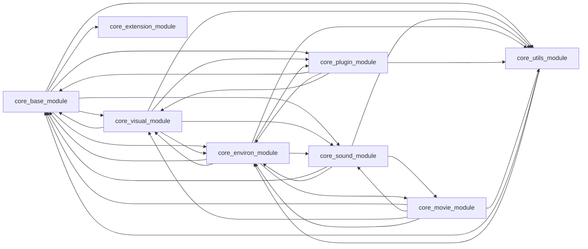
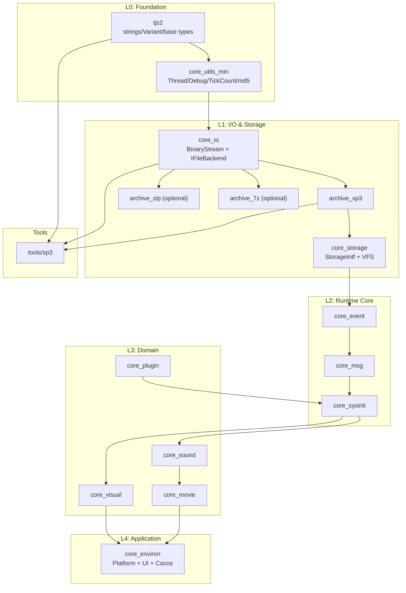

# Core Module Decoupling and xp3 Tool Refactor Analysis

<<<<<<<< Updated upstream:.agents/notes/archived/architecture/2026-06-09-core-module-decoupling.md
Status: archived

历史分析：保留原始诊断和当时计划，部分路径与结论已经过时；不据此恢复旧实现或执行旧工具链修改。

> 历史分析说明（2026-11-02 更新）：部分拆分已落地，当前 XP3 工具显式链接 `core_storage_archive`、`archive_xp3`，不再链接 `core_base_module`。下文保留当时分析和阶段计划；当前结构以[架构导航](../../../../docs/architecture.md)与模块 CMake 为准，后续工作见[后端精简路线](../../proposed/architecture/2026-11-03-backend-modernization.md)。

> **文档版本：** 2026-06-09\
> **相关路径：** `cpp/core/`、`tools/xp3/`\
> **背景：** xp3 解包工具只需虚拟文件系统能力，但当前链接 `core_base_module` 会间接拉入整个引擎栈
========
> **Document version:** 2026-06-09
> **Related paths:** `cpp/core/`, `tools/xp3/`
> **Background:** the xp3 extraction tool only needs the virtual file system, but linking
> `core_base_module` currently drags in the entire engine stack.
>>>>>>>> Stashed changes:docs/CORE_MODULE_DECOUPLING.md

---

## 1. Current State

### 1.1 What the xp3 tool actually needs

`tools/xp3/main.cpp` uses very few APIs:

```cpp
void extractArchive(const std::string &file, const std::string &destDir) {
    const std::unique_ptr<tTVPArchive> arc{ TVPOpenArchive(ttstr{ file }, false) };
    const tjs_uint count = arc->GetCount();
    for(tjs_int i = 0; i < count; i++) {
        ttstr name = arc->GetName(i);
        const std::unique_ptr<tTJSBinaryStream> src{ arc->CreateStreamByIndex(i) };
        // ... write to a local file
    }
}
```

Actual dependency chain:

| Layer | Component | Purpose |
|-------|-----------|---------|
| Strings/types | `tjs2` (`ttstr`, base types) | Paths and strings |
| Storage abstraction | `StorageIntf` (`tTVPArchive`, `TVPOpenArchive`) | Opening archives |
| XP3 implementation | `XP3Archive.cpp` | Parsing/decompressing XP3 |
| Stream I/O | `tTJSBinaryStream`, `TVPCreateStream` | Reading files |
| Compression | zlib | XP3 segment decompression |

Essentially it only needs a **virtual file system (VFS) + an XP3 archive reader**.

### 1.2 Current link relationships

`tools/xp3/CMakeLists.txt`:

```cmake
target_link_libraries(${PROJECT_NAME} PUBLIC tjs2 PRIVATE core_base_module)
```

Yet `core_base_module`'s CMake links almost every core module plus heavyweight third-party
libraries:

```cmake
target_link_libraries(${PROJECT_NAME} PUBLIC tjs2 PRIVATE
    core_visual_module core_plugin_module core_environ_module
    core_extension_module core_sound_module core_utils_module)

target_link_libraries(${PROJECT_NAME} PRIVATE
    uchardet::libuchardet unrar::unrar
    LibArchive::LibArchive zstd::libzstd
    cocos2dx::cocos2d)
```

**Building the xp3 tool indirectly pulls in: Cocos2d-x, OpenCV, FFmpeg, OpenAL, FreeType, WebP,
UI forms, the plugin system, etc. — none of which have anything to do with unpacking.**

---

## 2. Core Problem Diagnosis

### 2.1 Circular dependencies between modules (most severe)

The current CMake dependency graph contains cycles instead of a layered DAG:



Consequences:

- No single layer can be compiled or tested in isolation
- Tools are forced to link the entire engine
- Touching base can trigger a full rebuild
- The linker must resolve huge numbers of symbols — slow builds, large binaries

### 2.2 `core_base_module` has too many responsibilities (God Module)

`base` simultaneously contains:

| Category | Example sources | Needed by xp3? |
|----------|-----------------|----------------|
| Archive formats | XP3 / ZIP / 7z / TAR | XP3 only |
| Storage system | StorageIntf / Impl | Yes (but should be slimmed) |
| Script management | ScriptMgnIntf / Impl | No |
| Event system | EventIntf / Impl | No |
| System init | SysInitIntf / Impl | No |
| KAG parsing | KAGParser | No |
| Message system | MsgIntf / Impl | No |

`base` should be the low-level foundation, yet it has absorbed upper-layer business logic.

### 2.3 Source-level reverse dependencies (header/implementation leakage)

Low-level implementations directly `#include` upper-layer modules, e.g.:

**StorageImpl.cpp** (storage layer → game engine/UI):

```cpp
#include <cocos/cocos2d.h>
#include "WindowImpl.h"
#include "Application.h"
```

**ScriptMgnIntf.cpp** (script management → window/layer/audio/plugins):

```cpp
#include "WindowIntf.h"
#include "LayerIntf.h"
#include "CDDAIntf.h"
#include "MIDIIntf.h"
#include "WaveIntf.h"
#include "PluginIntf.h"
```

**SysInitImpl.cpp** (initialization → graphics/layers):

```cpp
#include "GraphicsLoaderIntf.h"
#include "LayerIntf.h"
```

This is **inverted architecture**: foundation depending on presentation/runtime instead of the
other way around.

### 2.4 Platform and engine coupled at the base layer

- `StorageImpl` uses Cocos2d `FileUtils` for file access
- `environ` contains the Cocos AppDelegate, SDL, UI forms
- Tools and unit tests cannot run without Cocos

### 2.5 Concrete pain points of the xp3 tool

| Problem | Impact |
|---------|--------|
| Links `core_base_module` | Pulls in 8 core modules |
| Indirect dependency on cocos2dx | Tool requires the full game engine from vcpkg |
| Indirect deps on FFmpeg / OpenCV etc. | Slow compiles, many dependencies |
| No headless minimal deployment | Huge tool binary |
| Cannot test XP3 parsing in isolation | Must boot the whole engine stack |

---

## 3. Target Architecture: Layered Decoupling

### 3.1 Recommended layers (bottom-up)



**Principles:**

1. **Dependencies may only point downward**; cycles are forbidden
2. **Separate interfaces from implementations** (`StorageIntf.h` must not include upper headers)
3. **Optional components** (ZIP/7z/TAR controlled by CMake options)
4. **Platform abstraction** (`IFileBackend`; default `StdFileBackend` uses `std::filesystem`)

### 3.2 The xp3 tool's ideal dependencies

```cmake
# Target state
target_link_libraries(xp3 PRIVATE
    tjs2
    core_io          # BinaryStream
    archive_xp3      # XP3 only
    core_storage_tool # TVPOpenArchive + local-file backend
)
# Does not link: visual, sound, movie, environ, cocos2dx
```

Expected outcome:

- Compile dependencies drop from ~30 vcpkg packages to **tjs2 + zlib + fmt/spdlog**
- Significantly shorter link times
- XP3 can get dedicated unit tests

---

## 4. Refactor Plan (Phased)

### Phase 0: Measurement and constraints (1–2 days)

1. Generate the module dependency graph with a script; CI forbids new cycles
2. List cross-layer `#include`s per module
3. Establish a minimal-link baseline for xp3 (current vs target)

### Phase 1: Extract `core_io` + `archive_xp3` (1 week, highest ROI)

**New modules:**

```
cpp/core/io/
├── BinaryStream.cpp/h
├── IFileBackend.h          # abstract file interface
├── StdFileBackend.cpp      # std::filesystem implementation
├── UtilStreams.cpp         # slimmed, Platform dependency removed
└── CMakeLists.txt

cpp/core/archive/
├── xp3/
│   ├── XP3Archive.cpp/h    # moved out of base
│   └── CMakeLists.txt
```

**Key changes:**

- In `XP3Archive.cpp`, `TVPCreateStream` → inject `IFileBackend`
- Remove unneeded includes like `MsgIntf.h`, `EventIntf.h`, `SysInitIntf.h`
- Keep the XP3 extraction filter's callback interface (existing
  `tTVPXP3ArchiveExtractionFilter`)

**xp3 tool CMake becomes:**

```cmake
target_link_libraries(xp3 PRIVATE tjs2 core_io archive_xp3)
```

### Phase 2: Slim down `core_storage` (1–2 weeks)

1. **Remove** `#include <cocos/cocos2d.h>` and `WindowImpl.h` from `StorageImpl.cpp`
2. Route all file access through `IFileBackend`:
   - Runtime: `CocosFileBackend` (registered in environ)
   - Tools/tests: `StdFileBackend`
3. Keep `TVPOpenArchive`, but turn the archive-creator table into a **registration mechanism**
   instead of hardcoding every format:

```cpp
// Registry-based; tools register only XP3
TVPRegisterArchiveCreator(tTVPXP3Archive::Create);
```

4. Split ZIP/7z/TAR into standalone `archive_*` libraries, linked on demand

### Phase 3: Split `core_base_module` (2–3 weeks)

| New module | Migrated out of base | Depends on |
|------------|----------------------|------------|
| `core_event` | EventIntf/Impl | io, utils |
| `core_msg` | MsgIntf/Impl | event |
| `core_sysinit` | SysInitIntf/Impl | storage, msg |
| `core_script` | ScriptMgnIntf/Impl | sysinit, tjs2 |
| `core_kag` | KAGParser | script |

**Delete base's CMake links to other domain modules**; domain modules depend on the runtime
core instead.

### Phase 4: Break the domain cycles (2–3 weeks)

Typical resolutions for the current cycles:

| Cycle | Solution |
|-------|----------|
| base ↔ visual | base keeps interfaces only; visual implements and registers them |
| environ ↔ visual/sound | environ becomes the **composition root**, injecting dependencies at startup |
| utils ↔ environ | utils drops its environ dependency; platform-specific bits move to environ |
| sound ↔ movie | movie depends on sound (one direction); sound never depends on movie |

**Dependency-injection example:**

```cpp
// environ/Application.cpp - the single assembly point
void TVPInitializeModules() {
    TVPSetFileBackend(std::make_unique<CocosFileBackend>());
    TVPRegisterArchiveCreators({ XP3, ZIP, ... });
    TVPSetSoundBackend(...);
}
```

### Phase 5: Unify the `krkr2core` interface library (optional)

Keep the existing `krkr2core` INTERFACE target for the main program, internally restructured as:

```cmake
target_link_libraries(krkr2core INTERFACE
    tjs2 core_io core_storage core_event core_msg core_sysinit
    core_visual core_sound core_movie core_plugin core_environ
)
```

Tools link only the subset they need.

---

## 5. Three implementation paths for "VFS-only" xp3

### Option A: Minimal linking (recommended, moderate changes)

- Keep the existing `TVPOpenArchive` API
- Create `core_io` + `archive_xp3` + `core_storage_tool`
- The xp3 tool changes almost no code, only CMake
- **Pros:** identical behavior to the engine, filter-compatible
- **Cons:** still depends on some tjs2 infrastructure

### Option B: Standalone XP3 library (zero engine dependencies)

- New `libxp3`, depending only on C++17 + zlib
- Self-contained XP3 index/segment parsing (pure logic extracted from `XP3Archive.cpp`)
- The xp3 tool calls `libxp3::extract(path, dest)` directly
- **Pros:** fully independent, publishable as a general-purpose tool
- **Cons:** filter/encryption logic must be kept in sync with the engine

### Option C: Short-term workaround

- xp3 tool CMake temporarily stops linking `core_base_module`
- Compile only `XP3Archive.cpp` + slimmed `StorageIntf.cpp` + `BinaryStream.cpp`
- Use an `OBJECT` library or source lists compiled straight into xp3
- **Pros:** fastest results
- **Cons:** technical debt, hard to maintain

**Recommendation: Option A for Phase 1; in the long run evolve toward Option B for external
use.**

---

## 6. Key Interface Design Drafts

### 6.1 File backend abstraction

```cpp
// core/io/IFileBackend.h
struct IFileBackend {
    virtual ~IFileBackend() = default;
    virtual std::unique_ptr<tTJSBinaryStream> OpenRead(const ttstr& path) = 0;
    virtual bool Exists(const ttstr& path) = 0;
    virtual ttstr GetLocalPath(const ttstr& path) = 0; // empty = not local
};

// Injected globally or via context, replacing hardcoding inside TVPCreateStream
void TVPSetFileBackend(std::unique_ptr<IFileBackend> backend);
```

### 6.2 Archive registration

```cpp
using ArchiveCreatorFn = tTVPArchive*(*)(const ttstr&, tTJSBinaryStream*, bool);
void TVPRegisterArchiveCreator(ArchiveCreatorFn fn);
tTVPArchive* TVPOpenArchive(const ttstr& name, bool normalize);
```

Tool startup:

```cpp
TVPSetFileBackend(std::make_unique<StdFileBackend>());
TVPRegisterArchiveCreator(tTVPXP3Archive::Create);
```

### 6.3 Module dependency rules (CI-enforced)

```
Allowed:  L(n) → L(n-1), L(n-2), ...
Forbidden: L(n) → L(n+1)
Forbidden: same-layer mutual dependencies (unless via interface + registration)
```

---

## 7. Risks and Caveats

| Risk | Mitigation |
|------|------------|
| `StorageImpl` is large (~1400 lines); splitting risks regressions | Add XP3 unit tests first, then refactor |
| XP3 encryption/filters coupled to the `xp3filter` plugin | Keep filters as callbacks; the plugin registers at runtime |
| Behavioral differences between Cocos FileUtils and std::filesystem | Abstraction layer + comparative tests |
| Full refactor takes a long time | Phase it; each phase independently verifiable via the xp3 tool |
| Existing plugins depend on the `krkr2core` monolith | Keep the INTERFACE aggregate target; split it internally step by step |

---

## 8. Priority Recommendations

| Priority | Task | Expected benefit |
|----------|------|------------------|
| P0 | Create `core_io` + `archive_xp3`; switch xp3's CMake | Tool compiles lightweight |
| P0 | Remove direct cocos/Window includes from StorageImpl | Breaks the worst reverse dependency |
| P1 | Split base → event/msg/sysinit/script | Clear module boundaries |
| P1 | De-cycle CMake + CI dependency check | Prevents regression |
| P2 | Optional ZIP/7z/TAR archive components | Link on demand |
| P2 | Standalone `libxp3` for external use | Tool becomes a product |
| P3 | environ as the sole composition root | Final architecture state |

---

## 9. Summary

**Root problem:** `core_base_module` is both the "foundation layer" and the "aggregate layer";
its CMake and sources depend bidirectionally on all domain modules, forcing VFS-only tools like
xp3 to link the whole KrKr2 engine (Cocos, FFmpeg, OpenCV, UI, …).

**Decoupling essentials:**

1. **Vertical layering:** Foundation → I/O/Storage → Runtime → Domain → Application
2. **Horizontal splitting:** base splits by responsibility into io, storage, event, msg, sysinit, …
3. **Dependency injection:** file backends, archive creators, platform services assembled in environ
4. **xp3 short term:** link only `tjs2 + core_io + archive_xp3`
5. **Long term:** optional standalone `libxp3`, maintained in parallel with the engine

---

## 10. Phase Progress Overview (2026-06-09)

| Phase | Status | Contents |
|-------|--------|----------|
| Phase 1 | ✅ done | `core_io`, `archive_xp3`, `core_storage_tool`, xp3 lightweight linking |
| Phase 2 | ✅ mostly done | IFileBackend, archive splitting, `core_storage`, tool chain `core_storage_tool` |
| Phase 3 | 🔄 in progress | `TArchiveStream` sunk down, CI dependency check, splitting `base` submodules |
| Phase 4 | ⏳ pending | De-cycle CMake, environ composition root |
| Phase 5 | ⏳ optional | `krkr2core` interface library refinement |

### Phase 2 — completed

- `StorageImpl` no longer includes `cocos/cocos2d.h`
- `IFileBackend` + `LocalFileBackend` / `MobileFileBackend` / `StdFileBackend`
- `EnvironFileBackendInit`; conditional Cocos compilation on mobile
- Removed `ChainedFileBackend`
- Removed the unused `WindowImpl.h` from `StorageImpl`
- `ArchiveRegistry`: registry of archive creators (engine: ZIP/7z/TAR/XP3; tools: XP3 only)
- **`core_storage` library** — `StorageIntf`, `UtilStreams`, `ArchiveRegistry`,
  `TVPInitToolStorage()`; `base` links `core_storage`; engine archives registered via
  `TVPInitEngineArchiveCreators()`
- **`archive_zip` / `archive_7z` / `archive_tar`** — moved out of `base`; `storeFilename`
  extracted into `core_storage/impl/ArchiveFilename.cpp`
- **`core_storage_tool`** — former `storage_min` moved to `cpp/core/storage/tool/`; xp3
  relinked to it

### Phase 2 — leftovers

1. **xp3 links the full `core_storage`** — `TVPCreateStream` still needs to be split out of
   `StorageIntf.cpp` (engine version vs tool version)

### Phase 3 — completed (initial steps)

| Change | Notes |
|--------|-------|
| `core_storage/impl/ArchiveStream.cpp` | `TArchiveStream` moved out of `StorageImpl.cpp` |
| `scripts/check_core_module_deps.py` | Parses CMake link relationships, detects new dependency cycles |
| **`core_msg`** | `MsgIntf.cpp` / `MsgImpl.cpp` built as an independent library; dropped `ApplicationSpecialPath` / unused `PluginImpl` dependency |

### Phase 3 — next steps

1. ~~**Split `core_msg`**~~ ✅
2. **Split `core_event`** — `EventIntf` / `EventImpl` (depends on Window/environ, significant work)
3. **Split `core_sysinit` / `core_script`** — migrate step by step per the table above
4. **De-cycle CMake** — remove base's PRIVATE links to visual/sound/environ
5. **CI integration** — run `check_core_module_deps.py` in CI

---

## 11. Phase 2 First-Step Progress (2026-06-09)

Completed:

| Change | Notes |
|--------|-------|
| `cpp/core/common/TVPPlatform.h` | Replaced cocos platform macros with `TargetConditionals.h` |
| `StorageImpl.cpp` | Removed `#include <cocos/cocos2d.h>`; `tTVPFileMedia::Open` read paths go through `IFileBackend` first |
| `cpp/core/environ/CocosFileBackend.*` | Mobile reads packed resources through `FileUtils` |
| `TVPInitEnvironFileBackends()` | Desktop: `LocalFileBackend`; mobile: `MobileFileBackend` (conditional CMake compilation) |
| Removed `ChainedFileBackend` | No more chained rollback; mobile explicitly tries Cocos first, then Local, inside `MobileFileBackend` |
| `core_io` class rename | `tTVPLocalFileStream` → `tTVPStdioFileStream`, avoiding a clash with `StorageImpl.h` |
| `core_base_module` | Now links `core_io` `PUBLIC` |

Desktop behavior is unchanged (no `CocosFileBackend` registered; still the original
`tTVPLocalFileStream` path).

---

## 12. Phase 1 Landing Progress (2026-06-09)

Changes completed:

| Module | Path | Notes |
|--------|------|-------|
| `core_io` | `cpp/core/io/` | `IFileBackend`, `StdFileBackend`, `tTVPLocalFileStream` |
| `archive_xp3` | `cpp/core/archive/xp3/` | `XP3Archive.cpp/h` moved out of `base` |
| `core_msg` | `cpp/core/msg/` | Message strings, `TVPFormatMessage`, version info (headers still in `base/`) |
| `core_storage_tool` | `cpp/core/storage/tool/` | Tool-chain storage layer + runtime stubs (formerly `storage_min`) |
| `archive_zip` | `cpp/core/archive/zip/` | ZIP archive |
| `archive_7z` | `cpp/core/archive/7z/` | 7z archive |
| `archive_tar` | `cpp/core/archive/tar/` | TAR archive |
| `xp3` tool | `tools/xp3/CMakeLists.txt` | Links `tjs2 + core_io + core_storage_tool`; no longer links `core_base_module` |

`core_base_module` now links `archive_xp3` `PUBLIC`; main-program behavior unchanged.

**xp3 tool dependencies now (vs before the refactor):**

- Before: indirectly linked cocos2dx / FFmpeg / OpenCV / all core modules
- After: `tjs2`, `zlib`, `fmt`, `spdlog`, `oniguruma`, `Boost::locale` (transitively via tjs2)

---

## 13. Related File Index

| Path | Description |
|------|-------------|
| `tools/xp3/main.cpp` | xp3 extraction tool entry point |
| `tools/xp3/CMakeLists.txt` | Current linking (tjs2 + core_io + core_storage_tool) |
| `cpp/core/base/CMakeLists.txt` | base module dependency definitions |
| `cpp/core/archive/xp3/` | XP3 archive implementation (moved out of base) |
| `cpp/core/storage/` | `core_storage`: `StorageIntf`, `UtilStreams`, `ArchiveRegistry`, `ToolStorageInit` |
| `cpp/core/base/StorageIntf.h` | Storage/VFS abstract interfaces (implementation compiled into `core_storage`) |
| `cpp/core/base/impl/StorageImpl.cpp` | Storage implementation |
| `cpp/core/CMakeLists.txt` | krkr2core aggregate target |
| `cpp/plugins/xp3filter.cpp` | XP3 decryption/filter plugin |
