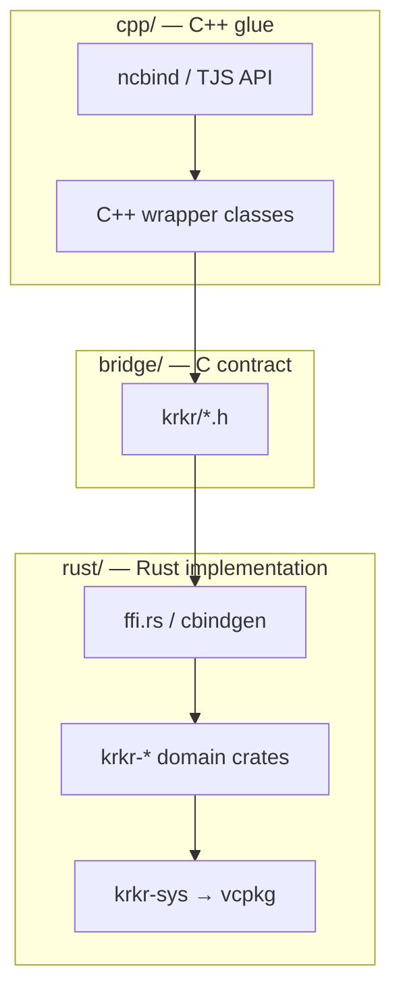

# Directory and Layering Architecture

<<<<<<<< Updated upstream:.agents/notes/proposed/architecture/2026-11-03-rust-architecture.md
Status: proposed

方案材料：本页包含待实施的接口或目录设计，不能作为当前构建与可用功能说明；事实以源码及 docs 为准。

[← 索引](2026-11-03-rust-overview.md)
========
[← Index](README.md)
>>>>>>>> Stashed changes:docs/rust/architecture.md

---

## 1. Design goals

<<<<<<<< Updated upstream:.agents/notes/proposed/architecture/2026-11-03-rust-architecture.md
| 目标 | 做法 |
|------|------|
| **可扩展** | 每块重写 = 独立 Rust crate + 独立 C++ 薄壳 |
| **语言边界清晰** | Rust 只在 `rust/`；C++ 只在 `cpp/`；契约在 `bridge/` |
| **依赖不重复** | zlib/lz4 等以 **vcpkg 为唯一来源**（见 [dependencies.md](2026-11-03-rust-dependencies.md)） |
| **渐进迁移** | 模块可独立开关；C++ 与 Rust 路径可并存 |
| **多平台** | 与 `out/linux|macos|windows|android` 及 `vcpkg_android.cmake` 一致 |
========
| Goal | Approach |
|------|----------|
| **Extensible** | Each rewrite = an independent Rust crate + an independent thin C++ shell |
| **Clear language boundary** | Rust only in `rust/`; C++ only in `cpp/`; contracts in `bridge/` |
| **No duplicate dependencies** | zlib/lz4 etc. come from **vcpkg as the single source** (see [dependencies.md](dependencies.md)) |
| **Incremental migration** | Modules can be switched independently; C++ and Rust paths can coexist |
| **Multi-platform** | Consistent with `out/linux\|macos\|windows\|android` and `vcpkg_android.cmake` |
>>>>>>>> Stashed changes:docs/rust/architecture.md

---

## 2. Repository layout

```text
krkr2/
├── vcpkg.json
├── cmake/
│   ├── KrkrRust.cmake
│   └── vcpkg_android.cmake
<<<<<<<< Updated upstream:.agents/notes/proposed/architecture/2026-11-03-rust-architecture.md
├── .agents/notes/proposed/architecture/ # Rust 迁移提案
├── rust/                              # ★ 全部 Rust 源码
========
├── docs/rust/                         # ★ Rust layer docs
├── rust/                              # ★ all Rust sources
>>>>>>>> Stashed changes:docs/rust/architecture.md
│   ├── krkr-ffi/
│   ├── krkr-sys/{zlib,lz4,…}
│   ├── crates/{krkr-psb,…}
│   └── tools/
├── bridge/
│   ├── include/krkr/{common.h,psb.h,…}
│   └── manifest.toml
├── cpp/plugins/{psbfile,motionplayer,…}
└── out/<platform>/<config>/
    └── rust-target/<triple>/<profile>/
```

**Do not put `.rs` files under `cpp/plugins/`.** For example, `cpp/plugins/psbfile/` keeps only
the TJS, ncbind, and `PSBFile` wrapper code.

---

## 3. Three-layer responsibilities



| Directory | Put here | Do not put here |
|-----------|----------|-----------------|
| `rust/crates/*` | Unit-testable parsing and algorithms | `tjs.h`, `ncbind` |
| `rust/krkr-sys/*` | `build.rs` linking against vcpkg | Business logic |
| `bridge/include` | Stable C headers | Implementation details |
| `cpp/plugins/*` | Plugin registration, type conversion | Large algorithm bodies (delete after migrating) |

---

## 4. Extending to more modules

<<<<<<<< Updated upstream:.agents/notes/proposed/architecture/2026-11-03-rust-architecture.md
1. 在 `rust/crates/` **新增 crate**
2. 在 `bridge/manifest.toml` **登记一行**
3. 在 `cpp/plugins/<name>/CMakeLists.txt` **链入 staticlib**
4. 先在 `.agents/notes/proposed/architecture/` 记录模块提案，实现后将稳定接口说明放入 `docs/subsystems/`
========
1. **Add a crate** under `rust/crates/`
2. **Register one line** in `bridge/manifest.toml`
3. **Link the staticlib** in `cpp/plugins/<name>/CMakeLists.txt`
4. **Add a module doc** under `docs/rust/modules/`
>>>>>>>> Stashed changes:docs/rust/architecture.md

```toml
[[module]]
name = "psb"
crate = "krkr-psb"
ffi_header = "bridge/include/krkr/psb.h"
cpp_glue = "cpp/plugins/psbfile"
abi_version = 1
```

**Naming:** Rust package `krkr-<domain>`; C symbol prefix `krkr_psb_` / `krkr_motion_`.

**Dependency direction (within Rust):**

```text
krkr-psb  ──►  krkr-ffi, krkr-sys/zlib (as needed)
krkr-motion-*  ──►  krkr-psb
```

Only boundaries that "must be called from C++" go through `ffi.rs` + `bridge/include`.
